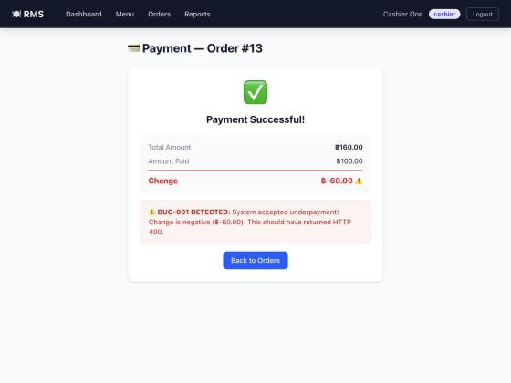
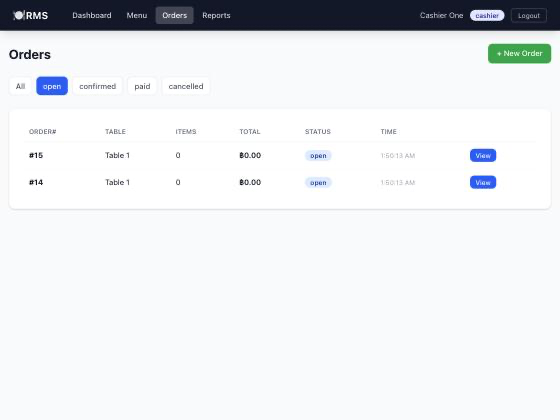
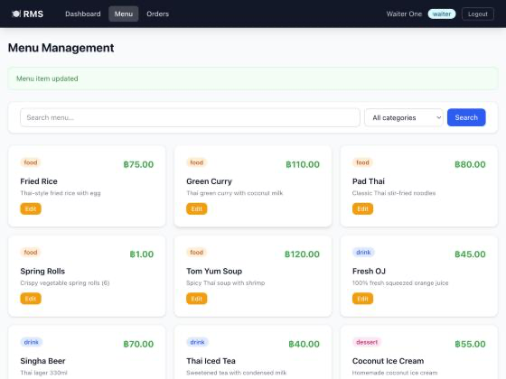
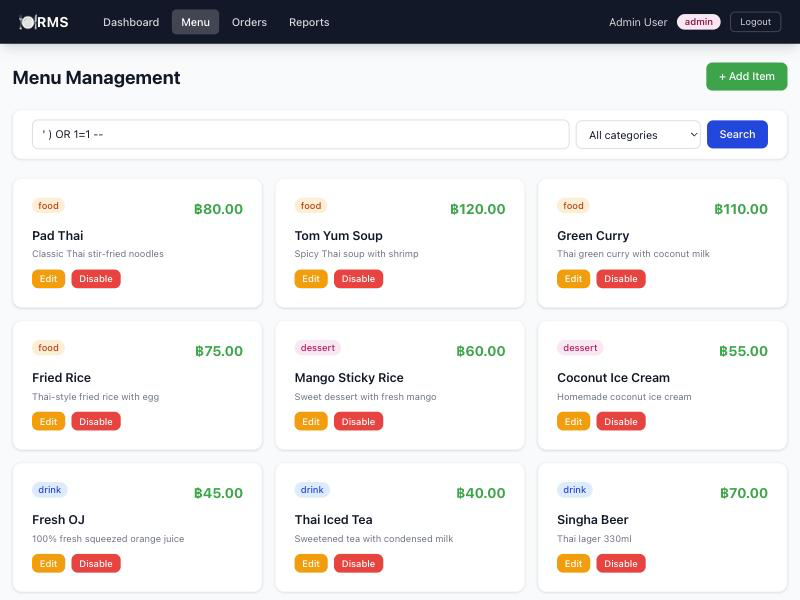

# Restaurant Management System

**ผู้จัดทำ:** นายวสุรัชต์ สมเด็จ  
**รหัสนักศึกษา:** 68030263  
**รายวิชา:** การออกแบบและพัฒนาซอฟต์แวร์ 1  
**วันที่จัดทำ:** 14 ตุลาคม 2569

> สถานะล่าสุด (15 ตุลาคม 2569): build และ Docker Staging ผ่าน audit Backend/Frontend ไม่พบช่องโหว่ (0/0) Newman ผ่าน20/25 หรือ80% ยืนยันบั๊ก4รายการ Unit/APIเดิมผ่าน19/20 On-Premises (PostgreSQL 16.15, API และ Frontend 5173 เข้าสู่ระบบได้) Self-Hosted Runner online และ CI job onprem รันบนเครื่องนี้ ยังไม่ได้ deploy Neon/Render/Vercel และยังไม่มี Production smoke test

## Project Overview

ผมจัดทำแผนทดสอบระบบจัดการร้านอาหารตามข้อสอบ โดยใช้โค้ดจากรีโพสิทอรี่ของอาจารย์ ครอบคลุมการเข้าสู่ระบบ เมนู ออเดอร์ ชำระเงิน และรายงานยอดขาย ผมให้ความสำคัญกับยอดเงินที่ถูกต้องและสิทธิ์ของพนักงาน เพราะความผิดพลาดส่งผลต่อรายได้โดยตรง

ต้นฉบับ: https://github.com/surachai-p/Restaurant-Management-System-Exam-2025  
รายละเอียดแหล่งที่มาอยู่ใน [SOURCE-PROVENANCE.md](SOURCE-PROVENANCE.md)

ผมอ่านโค้ดผ่าน GitHub ได้ แต่คำสั่ง git clone บนเครื่องนี้ไม่สำเร็จเพราะ DNS ดังนั้นโฟลเดอร์นี้เป็นสำเนาซอร์ส ไม่ใช่การโคลนที่มีประวัติ Git ครบ ต้องใช้ scripts/prepare-submission.sh ก่อนสร้างคอมมิตและส่งจริง

## Tech Stack

| ส่วน | ตามโจทย์และซอร์ส | สถานะที่ตรวจได้ |
|---|---|---|
| Frontend | React18, Vite8.3.4, TypeScript, Tailwind4.3.3, React Router7.18.4 | buildผ่านหลังอัปเกรด |
| Backend | Node.js 22, Express, TypeScript | เครื่องมี Node.js 22.17.1 และ npm 11.11.0 |
| Database | PostgreSQL16 และ Prisma5.22.0 | เชื่อมฐานข้อมูลDockerและรันNewmanแล้ว |
| Unit/API | Vitest และ Supertest | ผ่าน19/20; helperเดิมไม่ใช่production route |
| Integration | Postman และ Newman | รันครบ25กรณี ผ่าน20 ไม่ผ่าน5 |
| Staging | Docker Compose | db/backend/frontend Healthy และhealthผ่าน |
| Cloud | Neon, Render, Vercel | render.yml แก้เป็น Native Node แล้ว (ยังไม่ deploy รอบัญชีผู้ใช้) |

เวอร์ชัน dependency ที่แน่นอนต้องยึด package-lock.json ของแต่ละส่วน ไม่ใช้เวอร์ชันในแผนแทนเวอร์ชันที่ติดตั้งจริง

## Production URLs

| รายการ | URL / สถานะปัจจุบัน |
|---|---|
| GitHub Public ของผม | https://github.com/wasuratsomdet9009/Restaurant-Management-System-Exam-2025 — รีโพสิทอรี่เดิม; งานรอบนี้อยู่ในสาขา submission/68030263-20261015 (push แล้ว ล่าสุด 3ab5163) |
| Frontend เดิม | https://restaurant-management-system-exam-2-kappa.vercel.app — ตรวจก่อนรอบนี้: /login โดยตรงได้ 404 ไม่ใช่หลักฐานของสาขานี้ |
| Backend Health เดิม | https://restaurant-management-system-exam.onrender.com/api/health — ตรวจก่อนรอบนี้: แสดง Application loading ไม่ใช่ JSON ไม่ใช่หลักฐานของสาขานี้ |

ผมยังไม่นับURLเก่าเป็นหลักฐานการdeployซอร์สรอบนี้ และไม่ใส่connection stringของฐานข้อมูลในรายงาน

## Test Plan

### ขอบเขตการทดสอบ

**In Scope:** Auth ทั้งสามบทบาท; เพิ่ม อ่าน แก้ไข และปิดเมนู; เปิดโต๊ะ เพิ่มสินค้า ยืนยันและยกเลิกออเดอร์; เงินทอน การจ่ายไม่ครบและการจ่ายซ้ำ; รายงานยอดขาย; JWT และการจำกัดสิทธิ์; health check; Docker และ CI/CD

**Out of Scope:** Payment Gateway จริง เครื่องพิมพ์ใบเสร็จจริง และโหลดระดับหลายพันผู้ใช้ เพราะโจทย์ไม่ได้ให้บริการหรืออุปกรณ์สำหรับทดสอบ ผมจะไม่ใช้ผล API แทนผลทดสอบเครื่องพิมพ์

**ช่องว่างที่พบ:** schema.prisma ไม่มีโมเดลสต็อกวัตถุดิบ จึงยังทดสอบการตัดสต็อกตามคำบรรยายโจทย์ไม่ได้ ต้องระบุเป็นข้อจำกัดของระบบ ไม่บันทึกว่าผ่าน ฟังก์ชันรายเดือนตรวจผ่านช่วงวันที่ของ /reports/sales ส่วนความถูกต้องของยอดต้องเทียบกับข้อมูล fixture เพิ่มเติม

### แนวทางการทดสอบ

1. Unit/API ด้วย Vitest เพื่อตรวจการคำนวณและ HTTP โดยใช้ mock ตามชุดเดิม
2. Integration ด้วย Postman/Newman กับ PostgreSQL 16 จริง ตรวจทั้งสถานะ HTTP และข้อมูลที่ตอบกลับ
3. Security ตรวจโทเคน สิทธิ์การแก้ราคา และ SQL injection แบบอ่านข้อมูล เฉพาะฐานข้อมูลทดสอบของผม
4. Dependency scan ด้วย npm audit ทั้ง backend และ frontend
5. Smoke test บน Local, Staging และ Production: health, login, เปิดออเดอร์และเพิ่มสินค้า, ชำระเงิน
6. แยกการตรวจโค้ดออกจากผลรันจริง โดยแนบคำสั่งและหลักฐานของแต่ละประเภท

### สภาพแวดล้อมและข้อมูลทดสอบ

Local: Backend http://localhost:3001/api, Frontend http://localhost:5173  
Staging: Frontend http://localhost, Backend http://localhost:3001/api, PostgreSQL 16 ใน Docker  
CI: Ubuntu runner, Node.js 22, PostgreSQL 16 service ที่เปิดพอร์ต 5432

**เวอร์ชันสภาพแวดล้อมทดสอบ** (เวอร์ชันที่รันจริง; dependency ยึด package-lock.json)

| ส่วน | เวอร์ชัน | ใช้ที่ไหน |
|---|---|---|
| ระบบปฏิบัติการ | macOS 26.7 (Darwin 25.6.0), arm64 | Local, On-Premises, Staging, self-hosted runner |
| Node.js / npm | 22.17.1 / 11.11.0 | Local, On-Premises; CI ใช้ Node.js 22 |
| Docker / Docker Compose | 29.6.1 / v5.2.0 | Staging |
| PostgreSQL | 16.15 | Staging (image postgres:16), On-Premises; CI ใช้ image postgres:16 |
| Express / Prisma | 4.22.3 / 5.22.0 | Backend (package-lock.json) |
| TypeScript / Vitest | 5.9.3 / 4.1.11 | Backend, Unit/API |
| React / Vite / Tailwind CSS / React Router | 18.3.1 / 8.3.4 / 4.3.3 / 7.18.4 | Frontend (package-lock.json) |
| Newman / newman-reporter-htmlextra | 6.2.2 / 1.23.1 (local); CI ติดตั้ง newman@6 และ htmlextra@1 | Integration (Newman) |
| เบราว์เซอร์ทดสอบ UI | built-in browser ของ Claude desktop (ไม่ทราบเวอร์ชัน) | UI บน Staging และ On-Premises |
| CI runner | ubuntu-latest (job test); self-hosted macOS ARM64 (job onprem) | GitHub Actions |

ใช้ฐานข้อมูลทดสอบแยกจากข้อมูลร้านจริง บัญชี seed ได้แก่ admin, cashier1, waiter1 ชุดทดสอบสร้างเมนูชื่อ RMS 68030263 Fixture ราคา 80 บาท เลือกโต๊ะว่างและใช้ ID ที่ API ส่งกลับ ไม่ใช้เลขออเดอร์ที่คาดเดา หลังจบจะปิดเมนูทดสอบและยกเลิกออเดอร์ที่ค้าง แต่ประวัติการชำระเงินทดสอบยังอยู่ จึงห้ามรัน Collection ทั้งชุดกับข้อมูลจริง

### Entry Criteria

- ติดตั้ง dependencies, generate Prisma, สร้าง schema และ seed สำเร็จ
- API health ตอบ 200 และ status=ok
- บัญชีทั้งสามบทบาทล็อกอินได้ มีโต๊ะว่าง และฐานข้อมูลเป็นชุดทดสอบ
- กำหนด base_url ให้ตรง environment และมีชุดข้อมูลตั้งต้นที่ตรวจสอบได้

### Exit Criteria

ผมกำหนดให้ Test Cases ที่วางแผนไว้ผ่าน 100% และไม่มี Not Run หรือ Blocked ก่อนพร้อมส่งขึ้นใช้งาน ต้องไม่มีบั๊ก Critical/High ที่ยังเปิดอยู่ และ npm audit ต้องไม่พบ High/Critical ที่ยังไม่แก้ Smoke test ทั้ง 4 รายการต้องผ่านพร้อมหลักฐาน

Pass Rate ระดับกรณี = จำนวนกรณี Pass / จำนวนกรณีที่วางแผนทั้งหมด × 100  
อัตรา assertion ของ Newman คำนวณแยก ไม่ใช้แทนจำนวนกรณีทดสอบ

### Business Risk

| ความเสี่ยง | ผลกระทบ | การตรวจหลัก |
|---|---|---|
| รับเงินไม่ครบแต่ปิดบิล | ร้านสูญเสียรายได้ ยอดรับเงินจริงไม่ตรงยอดขาย | TC-021, TC-022 |
| เปิดหลายบิลบนโต๊ะเดียว | พนักงานสับสน เก็บเงินซ้ำหรือหลุดบิล | TC-015 |
| พนักงานเปลี่ยนราคาได้ | ลดราคาโดยไม่ได้รับอนุญาต | TC-010 |
| ค้นหาเมนูผ่าน SQL ที่ไม่ปลอดภัย | ข้อมูลนอกเงื่อนไขอาจถูกเปิดเผย | TC-011 |

## Test Cases & Results

ออกแบบ 25 กรณี: Positive 9, Negative 7, Security 7 และ Edge 2 มากกว่าขั้นต่ำในโจทย์ รวมกับคำขอ SETUP/CLEANUP เป็น 34 requests สคริปต์ตรวจสอบ 35 ชุด

| TC-ID | Feature | Scenario | Input | Expected | Actual | Pass/Fail |
|---|---|---|---|---|---|---|
| TC-001 | Health | Positive — ตรวจสถานะระบบ | GET health | 200 และ status=ok | HTTP 200; ดูผลรอบ 20261014T181929Z-72752 | Pass |
| TC-002 | Auth | Positive — เข้าสู่ระบบ admin | admin / รหัสบัญชีทดสอบ | 200 และ JWT | HTTP 200; ดูผลรอบ 20261014T181929Z-72752 | Pass |
| TC-003 | Auth | Positive — เข้าสู่ระบบ cashier1 | cashier1 / รหัสบัญชีทดสอบ | 200 และ JWT | HTTP 200; ดูผลรอบ 20261014T181929Z-72752 | Pass |
| TC-004 | Auth | Positive — เข้าสู่ระบบ waiter1 | waiter1 / รหัสบัญชีทดสอบ | 200 และ JWT | HTTP 200; ดูผลรอบ 20261014T181929Z-72752 | Pass |
| TC-005 | Auth | Negative — รหัสผ่านผิด | admin / wrong | 401 | HTTP 401; ดูผลรอบ 20261014T181929Z-72752 | Pass |
| TC-006 | Auth | Negative — ไม่ส่งข้อมูลล็อกอิน | {} | 400 | HTTP 400; ดูผลรอบ 20261014T181929Z-72752 | Pass |
| TC-007 | Menu | Security — อ่านเมนูโดยไม่มีโทเคน | ไม่ส่ง Authorization | 401 | HTTP 401; ดูผลรอบ 20261014T181929Z-72752 | Pass |
| TC-008 | Auth | Security — ใช้ JWT ปลอม | Bearer invalid | 401 | HTTP 401; ดูผลรอบ 20261014T181929Z-72752 | Pass |
| TC-009 | Menu | Positive — อ่านเมนู | โทเคนแอดมิน | 200 และ array | HTTP 200; ดูผลรอบ 20261014T181929Z-72752 | Pass |
| TC-010 | Menu | Security — พนักงานแก้ราคาเมนู | price=1 | 403 และราคาไม่เปลี่ยน | HTTP 200; ดูผลรอบ 20261014T181929Z-72752 | Fail |
| TC-011 | Menu | Security — ค้นหาด้วยข้อความ SQL | search=' ) OR 1=1 -- | 200 array ว่าง โดยค้นหาเป็นข้อความ | HTTP 200; ดูผลรอบ 20261014T181929Z-72752 | Fail |
| TC-012 | Menu | Security — พนักงานเพิ่มเมนู | ชื่อและราคาเมนู | 403 | HTTP 403; ดูผลรอบ 20261014T181929Z-72752 | Pass |
| TC-013 | Orders | Negative — เปิดออเดอร์ไม่ระบุโต๊ะ | {} | 400 | HTTP 400; ดูผลรอบ 20261014T181929Z-72752 | Pass |
| TC-014 | Orders | Positive — เปิดออเดอร์ใหม่ | table_id จากโต๊ะว่าง | 201 และ id | HTTP 201; ดูผลรอบ 20261014T181929Z-72752 | Pass |
| TC-015 | Orders | Negative — เปิดออเดอร์ซ้ำโต๊ะ | table_id เดิม | 409 | HTTP 201; ดูผลรอบ 20261014T181929Z-72752 | Fail |
| TC-016 | Orders | Edge — ยืนยันออเดอร์ว่าง | ออเดอร์ไม่มีสินค้า | 400 | HTTP 400; ดูผลรอบ 20261014T181929Z-72752 | Pass |
| TC-017 | Orders | Positive — เพิ่มสินค้า 2 ชิ้น | ราคา 80 จำนวน 2 | 201 และยอด 160 | HTTP 201; ดูผลรอบ 20261014T181929Z-72752 | Pass |
| TC-018 | Orders | Positive — ยืนยันออเดอร์ | ออเดอร์มีสินค้า | 200 confirmed | HTTP 200; ดูผลรอบ 20261014T181929Z-72752 | Pass |
| TC-019 | Payment | Edge — จ่ายเงินเกินยอด | ยอด160 จ่าย200 | 201 เงินทอน40 | HTTP 201; ดูผลรอบ 20261014T181929Z-72752 | Pass |
| TC-020 | Payment | Negative — จ่ายซ้ำออเดอร์ที่ชำระแล้ว | ออเดอร์ paid | 400 | HTTP 400; ดูผลรอบ 20261014T181929Z-72752 | Pass |
| TC-021 | Payment | Negative — จ่ายเงินไม่ครบยอด | ยอด160 จ่าย100 | 400 และยังไม่ paid | HTTP 201; ดูผลรอบ 20261014T181929Z-72752 | Fail |
| TC-022 | Orders | Negative — ตรวจสถานะหลังจ่ายไม่ครบ | underpaid_order_id | 200 status=confirmed และไม่มี payment | HTTP 200; ดูผลรอบ 20261014T181929Z-72752 | Fail |
| TC-023 | Report | Positive — อ่านรายงานยอดขาย | โทเคน cashier | 200 และ totalRevenue เป็นตัวเลข | HTTP 200; ดูผลรอบ 20261014T181929Z-72752 | Pass |
| TC-024 | Report | Security — พนักงานอ่านรายงานยอดขาย | โทเคน waiter | 403 | HTTP 403; ดูผลรอบ 20261014T181929Z-72752 | Pass |
| TC-025 | Payment | Security — ชำระเงินโดยไม่มีโทเคน | ไม่ส่ง Authorization | 401 | HTTP 401; ดูผลรอบ 20261014T181929Z-72752 | Pass |

ไฟล์: [RMS-68030263-TestSuite.json](tests/postman/RMS-68030263-TestSuite.json) และ [env.json](tests/postman/env.json)

ตัวแปร base_url, token, admin_token, cashier_token และ waiter_token ใช้ environment scope เดียวกัน เพื่อไม่ให้ค่าโทเคนเก่าใน environment ทับค่าที่บันทึกจาก login

การปรับจากชุดเดิม: ผมแยกออเดอร์จ่ายไม่ครบจากออเดอร์ที่ชำระแล้ว ใช้ ID จริงจากการสร้างข้อมูล ตรวจเงินทอนเป็น 40 บาทแบบเจาะจง และคืนราคาเมนูก่อนทดสอบการชำระเงิน ส่วน SQL search ใช้ payload ที่ปิดวงเล็บให้ครบและคาดหวังให้ค้นหาเป็นข้อความธรรมดา

## Test Reports

ผมรันบน Docker Staging กับ PostgreSQL16 ในรอบ `20261014T181929Z-72752` Newmanส่ง34คำขอ รวมsetup/cleanup และทดสอบครบ25กรณี

| ตัวชี้วัด | ผลจริง |
|---|---|
| กรณีผ่าน | 20/25 (80%) |
| กรณีไม่ผ่าน | 5 ได้แก่ TC-010,011,015,021,022 |
| Blocked/Not Run | 0 |
| Assertions ผ่าน | 40/46 (86.96%) |
| Unit/API เดิม | 19/20; unit helper ไม่ใช่หลักฐาน payment route |
| Docker | db/backend/frontend Healthy |
| Health | HTTP200 status=ok |

หลักฐานฉบับเผยแพร่ตัดโทเคนและคำขอloginออก: [measured-results.json](tests/reports/20261014T181929Z-72752/measured-results.json), [measured-results.html](tests/reports/20261014T181929Z-72752/measured-results.html) รายงานJSON/HTMLฉบับเต็มยังเก็บไว้ในเครื่องเพื่อใช้อ่านรายละเอียด

## Security Scan Report

ผมใช้ npm audit --audit-level=moderate ทั้งสองส่วน และ npm audit fix จากนั้นอัปเกรด dependency ที่ต้องข้ามเวอร์ชันหลัก พร้อมทดสอบbuild/Docker/Newmanซ้ำ ผลล่าสุดรอบ20261014T181929Z-72752 ไม่พบช่องโหว่ทั้งสองส่วน

| ส่วน/รอบ | Critical | High | Moderate | Low | รวม |
|---|---|---|---|---|---|
| Backend ก่อนแก้ |1|5|4|2|12|
| Frontend ก่อนแก้ |0|12|6|1|19|
| Backend หลังแก้ |0|0|0|0|0|
| Frontend หลังแก้ |0|0|0|0|0|

จำนวนนี้นับpackage entriesในnpm audit ไม่ใช่จำนวนCVEที่ไม่ซ้ำ ผล0ยืนยันเฉพาะdependencyชุดที่ตรวจ ไม่ได้หมายความว่าบั๊กในซอร์สหายไป

### Dependency ระดับ High/Critical ก่อนแก้

| ส่วน | Package | ระดับ | CVE ID (GHSA จาก audit) | เวอร์ชันหลังแก้ |
|---|---|---|---|---|
| backend | form-data | high | CVE-2026-12143 (GHSA-hmw2-7cc7-3qxx) | 4.0.6 |
| backend | nanoid | high | CVE-2026-67214 (GHSA-28wg-ghj8-5hjv); CVE-2026-67213 (GHSA-2v37-7h3g-55p8) | 3.3.20 |
| backend | postcss | high | CVE-2026-69153 (GHSA-fxqj-rqcc-2cmp); CVE-2026-73646 (GHSA-r28c-9q8g-f849) | 8.5.30 |
| backend | proxy-addr | critical | CVE-2026-90711 (GHSA-jqcg-44mw-7w3h) | 2.0.8 |
| backend | source-map-js | high | CVE-2026-93749 (GHSA-68fv-2mgg-jv7q) | 1.2.2 |
| backend | vite | high | CVE-2026-53632 (GHSA-v6wh-96g9-6wx3); CVE-2026-53571 (GHSA-fx2h-pf6j-xcff) | 8.3.4 |
| frontend | axios | high | CVE-2026-42044 (GHSA-3w6x-2g7m-8v23); CVE-2026-42264 (GHSA-q8qp-cvcw-x6jj); CVE-2026-44496 (GHSA-hfxv-24rg-xrqf); CVE-2026-44488 (GHSA-777c-7fjr-54vf); CVE-2026-44487 (GHSA-p92q-9vqr-4j8v); CVE-2026-44486 (GHSA-j5f8-grm9-p9fc); CVE-2026-44495 (GHSA-3g43-6gmg-66jw); CVE-2026-44494 (GHSA-35jp-ww65-95wh); CVE-2026-44490 (GHSA-898c-q2cr-xwhg); CVE-2026-44492 (GHSA-pjwm-pj3p-43mv); CVE-2026-67316 (GHSA-mmx7-hfxf-jppx); CVE-2026-67312 (GHSA-pmv8-rq9r-6j72); CVE-2026-67318 (GHSA-mwf2-3pr3-8698); CVE-2026-67319 (GHSA-7q8q-rj6j-mhjq); CVE-2026-67317 (GHSA-jqh4-m9w3-8hp9); CVE-2026-67315 (GHSA-f4gw-2p7v-4548); CVE-2026-67313 (GHSA-42h9-826w-cgv3); CVE-2026-67321 (GHSA-hcpx-6fm6-wx23); CVE-2026-101908 (GHSA-vh66-26gq-q6x8); CVE-2026-101902 (GHSA-9fr6-4gfg-395g); CVE-2026-101906 (GHSA-mghh-pgcx-3jjj); CVE-2026-101909 (GHSA-x97p-jq2g-jp4f); CVE-2026-101898 (GHSA-3pq3-5fj3-cg6v); CVE-2026-101901 (GHSA-542g-h47m-68v8); CVE-2026-101904 (GHSA-j8rh-479h-cp32); CVE-2026-101900 (GHSA-4hqw-qxg8-jxx2); CVE-2026-101899 (GHSA-44g4-m2mj-wpvx) | 1.20.0 |
| frontend | braces | high | CVE-2026-93687 (GHSA-vfj7-8cjw-p6xm) | ถอดออกจาก dependency tree |
| frontend | browserslist | high | CVE-2026-73089 (GHSA-c83g-rgw3-j3cx); CVE-2026-73088 (GHSA-73wf-gq98-2v4g) | 4.29.3 |
| frontend | chokidar | high | ผ่าน dependency: braces | ถอดออกจาก dependency tree |
| frontend | fast-glob | high | ผ่าน dependency: micromatch | ถอดออกจาก dependency tree |
| frontend | form-data | high | CVE-2026-12143 (GHSA-hmw2-7cc7-3qxx) | 4.0.6 |
| frontend | micromatch | high | ผ่าน dependency: braces | ถอดออกจาก dependency tree |
| frontend | nanoid | high | CVE-2026-67214 (GHSA-28wg-ghj8-5hjv); CVE-2026-67213 (GHSA-2v37-7h3g-55p8); CVE-2026-73086 (GHSA-xwg4-73v4-xw9w) | 3.3.20 |
| frontend | postcss | high | CVE-2026-45623 (GHSA-6g55-p6wh-862q); CVE-2026-69153 (GHSA-fxqj-rqcc-2cmp); CVE-2026-73646 (GHSA-r28c-9q8g-f849) | 8.5.30 |
| frontend | source-map-js | high | CVE-2026-93749 (GHSA-68fv-2mgg-jv7q) | 1.2.2 |
| frontend | tailwindcss | high | ผ่าน dependency: chokidar, fast-glob, micromatch | 4.3.3 |
| frontend | vite | high | CVE-2026-39365 (GHSA-4w7w-66w2-5vf9); CVE-2026-53632 (GHSA-v6wh-96g9-6wx3); CVE-2026-53571 (GHSA-fx2h-pf6j-xcff) | 8.3.4 |

CVE ID ดึงจาก GitHub Advisory Database ด้วย `gh api /advisories/<GHSA>` ทั้ง 42 รายการ (ไม่ได้เดาหมายเลข) เวอร์ชันในตารางเป็นเวอร์ชันที่ npm audit แนะนำให้แก้ และเวอร์ชันที่ติดตั้งจริงอยู่ใน lockfile ซึ่ง npm audit รอบล่าสุดไม่พบช่องโหว่ ไม่ใช่คำรับรองว่าไม่มีช่องโหว่ในอนาคต

หลักฐาน: `tests/reports/20261014T181929Z-72752/backend-audit-after.log` และ `frontend-audit-after.log` ผลbuildหลังอัปเกรดสำเร็จตามTerminal และDockerยังHealthy; UIหลังอัปเกรดยังต้องตรวจด้วยหน้าเว็บ

## Bug Reports

> Newman รอบ 20261014T181929Z-72752 ยืนยัน HTTP และฐานข้อมูลของบั๊กทั้ง 4 รายการ: BUG-001 จาก TC-021/022, BUG-002 จาก TC-015, BUG-003 จาก TC-010, BUG-004 จาก TC-011 ภาพหน้าจอ `tests/reports/bug-00X.png` ถ่ายจาก UI บน Staging (localhost) รอบ 15 ตุลาคม 2569 ไฟล์ต้นทางและ log อยู่ใน `tests/reports/20261015-ui-evidence/`

## BUG-001: รับเงินไม่ครบแต่บันทึกชำระสำเร็จ

**Severity:** Critical
**Priority:** P1
**Feature:** Payment

### Steps to Reproduce
1. ล็อกอิน waiter1 เปิดออเดอร์ที่โต๊ะว่าง เพิ่ม Pad Thai (฿80) จำนวน 2 แล้วกด Confirm Order ยอดรวม ฿160
2. ล็อกอิน cashier1 เปิดหน้าชำระเงินของออเดอร์นั้น เลือกวิธี Cash
3. กรอก Amount Paid = 100 แล้วกด Process Payment
4. ตรวจผลที่หน้าชำระเงินและสถานะออเดอร์ (API: `GET /api/orders/:id`)

### Expected Result
ระบบปฏิเสธการชำระเงินที่ยอดไม่ครบ ตอบ HTTP 400 ไม่สร้าง payment สถานะออเดอร์ยังเป็น confirmed และโต๊ะไม่ถูกปล่อยเป็น available

### Actual Result
ระบบบันทึกการชำระเงิน 100 จากยอด 160 โดยเงินทอนเป็น -60 (TC-021 ตอบ HTTP 201) ออเดอร์เปลี่ยนเป็น paid และมีรายการ payment (TC-022) หน้า UI แสดง "Payment Successful" ยอด 160 รับ 100 เงินทอน -60 พร้อมป้าย "BUG-001 DETECTED" ที่แอปแสดงเอง

### Evidence


ภาพขั้นตอนก่อนกดชำระ: [bug-001-cashier-underpayment-form-staging.jpg](tests/reports/20261015-ui-evidence/bug-001-cashier-underpayment-form-staging.jpg) ผลรายการทดสอบ: [measured-results.json](tests/reports/20261014T181929Z-72752/measured-results.json) (TC-021, TC-022) โค้ดที่เกี่ยวข้อง: [payments.ts](backend/src/routes/payments.ts)

### Business Impact
ร้านอาจรับเงินไม่ครบแต่ระบบบันทึกรายได้เต็มยอด ทำให้ยอดเงินสดไม่ตรงกับยอดขาย ลูกค้าที่จ่ายไม่ครบอาจถูกปิดบิลโดยไม่มีการเก็บยอดที่ขาด ส่งผลต่อรายได้ของร้านโดยตรง

### ข้อเสนอแนวทางแก้ไข
ตรวจว่า amountPaid เป็นตัวเลขและไม่น้อยกว่ายอดบิลก่อนเขียนข้อมูล แล้วทดสอบขอบเขตเงินทอนและสถานะออเดอร์ซ้ำด้วย TC-021/022

## BUG-002: เปิดออเดอร์ซ้ำบนโต๊ะเดียว

**Severity:** High
**Priority:** P1
**Feature:** Order

### Steps to Reproduce
1. ล็อกอิน waiter1 เปิดออเดอร์ใหม่ที่โต๊ะ 1 (ได้ออเดอร์ #14) โดยยังไม่ชำระหรือยกเลิก
2. ส่ง `POST /api/orders` ด้วย `{"tableId":1}` อีกครั้งขณะที่ออเดอร์แรกยังเป็น open
3. เปิดหน้า Orders (สถานะ open) ตรวจรายการออเดอร์ของโต๊ะ 1

### Expected Result
ครั้งที่สองตอบ HTTP 409 และโต๊ะมีออเดอร์ที่เปิดอยู่เพียง 1 รายการ

### Actual Result
`POST /api/orders` ครั้งที่สองตอบ HTTP 201 และสร้างออเดอร์ #15 ทำให้โต๊ะ 1 มีออเดอร์ open 2 รายการพร้อมกัน (#14 และ #15) หน้า Orders แสดงทั้งสองรายการ

### Evidence


log การเรียก API: [bug-002-duplicate-open-order-api.log](tests/reports/20261015-ui-evidence/bug-002-duplicate-open-order-api.log) โค้ดที่เกี่ยวข้อง: [orders.ts](backend/src/routes/orders.ts) บรรทัด 70-71 มีการตรวจออเดอร์ซ้ำอยู่ในคอมเมนต์และไม่ได้ทำงาน

### Business Impact
พนักงานอาจส่งอาหารหรือเรียกเก็บเงินซ้ำ และเมื่อปิดบิลใบใดใบหนึ่ง โต๊ะอาจแสดงว่าว่างทั้งที่อีกบิลยังค้างอยู่ ทำให้ยอดขายและการรับเงินคลาดเคลื่อน

### ข้อเสนอแนวทางแก้ไข
ตรวจออเดอร์ open ของโต๊ะภายใน transaction เดียวกับการสร้างออเดอร์ เพื่อรองรับคำขอพร้อมกัน ไม่ใช้เพียง findFirst นอก transaction

## BUG-003: พนักงานแก้ราคาเมนูได้

**Severity:** High
**Priority:** P1
**Feature:** Menu และสิทธิ์ผู้ใช้

### Steps to Reproduce
1. ล็อกอิน admin ตรวจว่าเมนู Spring Rolls ราคา ฿65
2. ล็อกอิน waiter1 เปิดหน้า Menu กด Edit ที่ Spring Rolls
3. เปลี่ยน Price เป็น 1 แล้วกด Save

### Expected Result
ระบบปฏิเสธการแก้ไข (HTTP 403) ราคาเดิมยังคงเป็น ฿65 และไม่ควรแสดงปุ่ม Edit ให้พนักงาน

### Actual Result
หน้า UI ของ waiter1 แสดงปุ่ม Edit และแก้ราคาได้ เมื่อกด Save ระบบแจ้ง "Menu item updated" และราคาเปลี่ยนเป็น ฿1.00 (Newman TC-010 ได้ HTTP 200 แทน 403 ตรงกับพฤติกรรมนี้) หลังทดสอบ admin ตั้งราคากลับเป็น ฿65 บน Staging แล้ว

### Evidence


log เครือข่าย: [bug-003-004-network-log.txt](tests/reports/20261015-ui-evidence/bug-003-004-network-log.txt) (`PUT /api/menu/5 -> 200 OK`) โค้ดที่เกี่ยวข้อง: [menu.ts](backend/src/routes/menu.ts) เส้นทาง PUT ใช้ authenticate แต่ไม่มี requireRole('admin')

### Business Impact
พนักงานที่ไม่มีสิทธิ์เปลี่ยนราคาได้ ทำให้ลดราคาโดยไม่ได้รับอนุญาต ยอดขายและรายรับผิดพลาด

### ข้อเสนอแนวทางแก้ไข
เพิ่ม `requireRole('admin')` ที่ `PUT /api/menu/:id` ใน backend และซ่อนปุ่ม Edit ใน frontend สำหรับบทบาทที่ไม่มีสิทธิ์ แล้วทดสอบ API โดยตรงซ้ำด้วย TC-010

## BUG-004: ค้นหาเมนูด้วย SQL ที่ต่อข้อความจากผู้ใช้

**Severity:** High
**Priority:** P1
**Feature:** Menu search

### Steps to Reproduce
1. ล็อกอินในระบบ (ทดสอบด้วย admin)
2. เปิดหน้า Menu พิมพ์ `' ) OR 1=1 --` ในช่องค้นหาแล้วกด Search (API: `GET /api/menu?search=' ) OR 1=1 --`)
3. ตรวจรายการเมนูที่แสดงกลับมา

### Expected Result
ค้นหาเป็นข้อความธรรมดา ไม่มีเมนูชื่อนี้จึงได้รายการว่าง (array ว่าง) และไม่แสดงข้อมูลนอกเงื่อนไข

### Actual Result
ระบบตอบ HTTP 200 และแสดงเมนูทั้ง 10 รายการ (log: `GET /api/menu?search=%27+)+OR+1%3D1+-- -> 200 OK`) แทนที่จะได้ array ว่าง

### Evidence


log เครือข่าย: [bug-003-004-network-log.txt](tests/reports/20261015-ui-evidence/bug-003-004-network-log.txt) โค้ดที่เกี่ยวข้อง: [menu.ts](backend/src/routes/menu.ts) และ Newman TC-011

### Business Impact
ผู้ใช้ที่ล็อกอินอาจอ่านรายการที่ระบบไม่ควรแสดง กระทบความปลอดภัยและความน่าเชื่อถือของข้อมูลในระบบที่มีข้อมูลการขายจริง

### ข้อเสนอแนวทางแก้ไข
ใช้ Prisma filter (เช่น `contains`) หรือ parameterized query แทนการต่อข้อความ แล้วตรวจซ้ำด้วย payload เดิม (ควรได้ array ว่าง)

### ข้อสังเกตเพิ่มเติม

reports.ts ใช้ gt สำหรับ startDate ทำให้ไม่รวมรายการที่ตรงขอบเวลาเริ่มต้นพอดี ต้องทดสอบด้วย fixture ที่กำหนดเวลาแน่นอนและระบุ timezone ให้ชัด ส่วนชุด unit เดิมคัดลอก helper คำนวณเงินไว้ใน test การแก้ route อย่างเดียวจึงยังไม่ทำให้ test นั้นสะท้อนพฤติกรรม route จริง ควรปรับให้เรียก production logic หรือ API ในรอบแก้บั๊ก

## Deployment Guide

### Prerequisites

Node.js 22+, Git, Docker Desktop/Compose, บัญชี GitHub ของผม, Neon, Render และ Vercel รวมถึงอินเทอร์เน็ตสำหรับติดตั้ง dependencies

ไม่เก็บ DATABASE_URL, JWT_SECRET, deploy hook หรือโทเคนจริงใน Git ใช้ environment ของบริการและ GitHub Secrets

### Local Setup (Docker Compose + Manual)

**เตรียมรีโพสิทอรี่ที่รักษาประวัติต้นฉบับ**
```bash
bash scripts/prepare-submission.sh /absolute/path/RMS-68030263-submission
cd /absolute/path/RMS-68030263-submission
# สร้าง repository ของตนเองผ่าน GitHub ก่อน
git remote add origin https://github.com/YOUR_ACCOUNT/RMS-68030263.git
git add .
git commit -m "Add test plan personalized suite and deployment configuration"
git push -u origin main
```

ต้องแทน YOUR_ACCOUNT และ path จริงก่อนใช้ ห้าม push ไปรีโพสิทอรี่ของอาจารย์

**Manual backend**
```bash
cd backend
cp .env.example .env
# แก้ DATABASE_URL, JWT_SECRET, PORT=3001 และ CORS_ORIGIN=http://localhost:5173
npm ci
npx prisma generate
npx prisma db push
npm run db:seed
npm run dev
```

**Manual frontend อีก terminal**
```bash
cd frontend
cp .env.example .env
# กำหนด VITE_API_URL=http://localhost:3001/api
npm ci
npm run dev -- --host 127.0.0.1
```

**Docker staging**
```bash
cp .env.example .env
# สุ่มค่า POSTGRES_PASSWORD และ JWT_SECRET คนละค่า แนะนำ hex เพื่อไม่ต้อง escape URL
docker compose up --build -d
docker compose ps
curl -f http://localhost:3001/api/health
```

เปิด http://localhost และล็อกอิน ตรวจ container ให้เป็น running/healthy ทุกตัว .env ต้องเปลี่ยนจาก placeholder ก่อนรันจริง ห้ามใช้ docker compose down -v กับฐานข้อมูลที่ต้องเก็บ

### On-Premises Setup

สำเร็จบนเครื่อง Mac (arm64): PostgreSQL 16.15 รันใน Docker ที่ 127.0.0.1:5432 (ฐานข้อมูล `rms_onprem` แยกจาก Staging) Backend ผ่าน `npm ci`, prisma generate, build, db push และ seed; Frontend ผ่าน `npm ci` และรัน Vite ที่พอร์ต 5173 เข้าสู่ระบบ admin ได้

การติดตั้ง Self-Hosted Runner ตามโจทย์: เข้า repository ของผม → Settings → Actions → Runners → New self-hosted runner เลือก OS/architecture ของเครื่อง ทำตามคำสั่งที่ GitHub สร้างให้และใช้ registration token เฉพาะรอบนั้น ติดตั้ง runner เป็น service ตามหน้าจอ และตรวจสถานะ Online ก่อนรันงาน ห้ามบันทึก registration token ในรายงาน

CI job `test` ใช้ GitHub-hosted runner (ubuntu) ส่วน job `onprem` รันบน self-hosted runner `rms-68030263-mac` (labels: self-hosted, macOS, ARM64) ที่ติดตั้งบนเครื่องนี้ ดูสถานะ runner ใน [runner-status.txt](tests/reports/20261015-onprem-run/runner-status.txt)

**หมายเหตุพอร์ต:** โจทย์ระบุ backend 3001 แต่ตัวอย่างภาพหลักฐานเขียน 3000 ผมยึด 3001 ตามซอร์สและส่วนติดตั้ง หากต้องการภาพที่ 3000 ให้ตั้ง PORT=3000 และแก้ VITE_API_URL ให้ตรงกัน ไม่อ้างว่าทั้งสองพอร์ตทำงานโดยไม่ได้รัน

**พอร์ตที่รันจริงรอบนี้:** Backend รันที่ **3101** (`PORT=3101`) และ Frontend ที่ `http://localhost:5173` ใช้ `VITE_API_URL=http://localhost:3101/api` เพราะพอร์ต 3001 ถูก Docker Staging ใช้อยู่ ต้องหยุด Staging ก่อนจึงรัน Backend ที่ 3001 ตามขั้นตอนโจทย์ได้ (รอการอนุมัติ)

หลักฐานที่มี: [health Backend 3101 (ภาพ)](tests/reports/20261015-onprem-run/onprem-api-health-3101.jpg), [health Backend 3101 (log curl)](tests/reports/20261015-onprem-run/onprem-health-3101.log), [หน้า login Frontend 5173](tests/reports/20261015-onprem-run/onprem-frontend-login-5173.jpg), [dashboard หลัง login admin 5173](tests/reports/20261015-onprem-run/onprem-frontend-admin-dashboard-5173.jpg), [log Backend](tests/reports/20261015-onprem-run/backend-api.log) ยังขาดภาพ health ที่เห็นแถบ address bar และการรันที่พอร์ต 3001 ตามโจทย์

### Staging Environment

docker-compose.yml เพิ่ม PostgreSQL 16, environment ครบ, backend port 3001, frontend port 80, healthcheck และ depends_on แบบ service_healthy แล้ว VITE_API_URL ถูกส่งเป็น build argument เพราะ Vite ฝังค่านี้ตอน build

ปรับ backend Dockerfile ให้ generate Prisma ก่อน build และ compile seed ระหว่าง build เพื่อลดการดาวน์โหลดเครื่องมือเพิ่มตอน start

ผลจริง: `docker compose ps` แสดง db, backend, frontend เป็น healthy ([docker-compose-ps.log](tests/reports/20261015-ui-evidence/docker-compose-ps.log)) health ตอบ `{"status":"ok"}` ([log](tests/reports/20261015-ui-evidence/staging-health-3001.log)) และทดสอบ UI บน `http://localhost` ครบ 4 ขั้นตอน (ดู Smoke Test Results)

หมายเหตุ: stack ที่รันอยู่ build จากโฟลเดอร์สำเนา `RMS-68030263` ซึ่ง docker-compose.yml, Dockerfile, backend/src, frontend/src, prisma และ lockfile เหมือนกับโฟลเดอร์นี้ (ตรวจด้วย diff แล้ว) ยังไม่ได้ rebuild ในโฟลเดอร์นี้ เพราะต้องหยุด stack เดิมที่ใช้พอร์ต 80/3001 ซึ่งยังไม่ได้รับอนุมัติ และภาพหน้าจอ Terminal ([docker-compose-ps-and-health-staging-terminal.png](tests/reports/20261015-ui-evidence/docker-compose-ps-and-health-staging-terminal.png)) แสดง `docker compose ps` (db, backend, frontend เป็น Up และ healthy) และ `curl -i http://localhost:3001/api/health` ตอบ HTTP 200 พร้อม `{"status":"ok"}`

### Neon.tech Database Setup

1. สร้าง Project ในบัญชีผม เลือก PostgreSQL 16 ตามข้อสอบ
2. คัดลอก connection string ที่มี sslmode=require ไปตั้ง DATABASE_URL โดยไม่ใส่ในรายงานหรือ Git
3. ใช้ฐานข้อมูล/branch สำหรับทดสอบแยกจาก production
4. รัน Prisma schema push และ seed เฉพาะฐานข้อมูลที่สร้างสำหรับงานนี้ แล้วตรวจข้อมูลเริ่มต้น

### Render + Vercel Deployment Steps

**Render backend**
- เชื่อม GitHub repository ของผม Root Directory = backend
- Build: npm ci && npx prisma generate && npm run build
- Start ตามข้อสอบ: npx prisma db push && npx tsx prisma/seed.ts && npm start
- ตั้ง DATABASE_URL, JWT_SECRET, CORS_ORIGIN และ NODE_ENV=production
- เก็บ dependencies สำหรับ prisma/tsx ตาม start command ไม่ตั้ง NPM_CONFIG_PRODUCTION=true ซึ่งจะตัด devDependencies ที่จำเป็น
- Build ใช้คำสั่งตามข้อสอบ `npm install && npx prisma generate && npm run build` เพราะ NODE_ENV=production ทำให้ npm ข้าม devDependencies (ตรวจแล้ว `npm config get omit` = dev) จึงเพิ่มไฟล์ [backend/.npmrc](backend/.npmrc) ที่ตั้ง `include=dev` ไว้ ทดสอบใน directory ชั่วคราวแล้ว: ไม่มี .npmrc ไม่มี tsc/tsx ใน node_modules/.bin แต่มีเมื่อใช้ .npmrc ไฟล์ [render.yml](render.yml) ตั้งค่าตามนี้ (native Node, rootDir backend)
- ตรวจ /api/health และบันทึก URL จริง

**Vercel frontend**
- Root Directory = frontend, Framework = Vite
- Build = npm run build, Output Directory = dist
- ตั้ง VITE_API_URL=https://BACKEND_HOST/api ก่อน build
- เมื่อได้ frontend URL แล้วนำไปตั้ง CORS_ORIGIN ของ Render และ deploy backend ใหม่
- มี vercel.json สำหรับ SPA deep links

**CI-controlled deployment**
- ตั้ง GitHub environment ชื่อ production และ secrets RENDER_DEPLOY_HOOK / VERCEL_DEPLOY_HOOK
- หากใช้ workflow เป็นตัวควบคุม deploy ต้องปิด automatic Git deploy ของทั้งสองบริการเพื่อไม่ให้ข้าม test gate
- HTTP สำเร็จจาก deploy hook หมายถึงรับคำขอ deploy ไม่ใช่ยืนยันว่าเว็บพร้อม ต้องตรวจสถานะบริการและ smoke test หลังจบอีกครั้ง
- ขณะยังมีบั๊ก Critical/High ให้ deploy เฉพาะงานสาธิตที่ใช้ข้อมูลทดสอบ หลังแก้บั๊กและผ่าน gate แล้วจึงพิจารณาใช้งานจริง

### Environment Variables Table

| ตัวแปร | ใช้ที่ไหน | ค่า/หลักการ |
|---|---|---|
| DATABASE_URL | Backend | PostgreSQL connection string; Neon ต้องมี SSL |
| JWT_SECRET | Backend | ค่าสุ่มยาวอย่างน้อย 32 ตัว ไม่ใช้ค่า fallback |
| CORS_ORIGIN | Backend | frontend origin เช่น http://localhost:5173 ไม่มี /api |
| NODE_ENV | Backend | development / test / production ตามบริบท |
| PORT | Backend | 3001 สำหรับ local; cloud ใช้พอร์ตจาก provider |
| VITE_API_URL | Frontend build | http://localhost:3001/api หรือ cloud backend ลงท้าย /api |
| POSTGRES_PASSWORD | Docker database | ค่าสุ่มสำหรับฐานข้อมูล staging |
| RENDER_DEPLOY_HOOK | GitHub Secrets | URL ลับของ Render |
| VERCEL_DEPLOY_HOOK | GitHub Secrets | URL ลับของ Vercel |

### Smoke Test Results

| Feature | On-Premises (Local) | Staging (Docker) | Production (Cloud) | หลักฐาน |
|---|---|---|---|---|
| Health status ok | ผ่าน: 127.0.0.1:3101 ตอบ 200 status=ok | ผ่าน: 127.0.0.1:3001 ตอบ 200 status=ok | Not Run: ยังไม่ deploy | [ภาพ 3101](tests/reports/20261015-onprem-run/onprem-api-health-3101.jpg), [log 3101](tests/reports/20261015-onprem-run/onprem-health-3101.log), [log Staging](tests/reports/20261015-ui-evidence/staging-health-3001.log) |
| Login admin | ผ่าน: admin เข้า dashboard ที่ localhost:5173 | ผ่าน: admin, cashier1, waiter1 เข้าระบบบน localhost | Not Run | [login Staging](tests/reports/20261015-ui-evidence/staging-login-localhost.jpg), [dashboard 5173](tests/reports/20261015-onprem-run/onprem-frontend-admin-dashboard-5173.jpg) |
| เปิดโต๊ะ เพิ่มสินค้า Confirm | Not Run (รอบนี้ยังไม่ได้ทำบน on-prem) | ผ่าน: Order #13 โต๊ะ 1 Pad Thai 2 ชิ้น รวม ฿160 สถานะ confirmed | Not Run | [ภาพ Order #13](tests/reports/20261015-ui-evidence/staging-order-13-confirmed-160.jpg) |
| Payment และเงินทอน | Not Run | ยืนยัน BUG-001: รับ 100 จากยอด 160 แสดง Payment Successful เงินทอน -60 | Not Run | [ภาพฟอร์ม](tests/reports/20261015-ui-evidence/bug-001-cashier-underpayment-form-staging.jpg), [ภาพผล](tests/reports/20261015-ui-evidence/bug-001-cashier-underpayment-result-staging.jpg) |

## CI/CD Pipeline + Newman Pass Rate

Workflow อยู่ที่ [.github/workflows/cicd.yml](.github/workflows/cicd.yml) ทำงานเมื่อ push ไป main หรือ submission/68030263-20261015, pull request เข้า main หรือสั่งเอง (job onprem ทำงานเฉพาะ push) ติดตั้ง Node.js 22, PostgreSQL 16, build ทั้งสองส่วน, รัน unit/API, audit และ Newman พร้อมเก็บรายงาน

ใช้ continue-on-error เฉพาะเพื่อให้เก็บผลหลายส่วนได้ครบ แต่มี final gate ตรวจ outcome ทุกส่วน หากมีข้อใดไม่สำเร็จ job จะ fail และ deploy ไม่ทำงาน ไม่ได้กลบผลทดสอบที่ล้มเหลว

**Run ล่าสุดบนสาขางาน:** https://github.com/wasuratsomdet9009/Restaurant-Management-System-Exam-2025/actions/runs/38628698763 (commit 224bc40)
- job `onprem` **success** บน self-hosted runner `rms-68030263-mac` (macOS ARM64): PostgreSQL 16 ชั่วคราว, build, db push, seed, API พอร์ต 3201, health และ admin login ผ่าน
- job `test` (GitHub-hosted, ubuntu) **failure** ตาม gate: Unit มี 1 กรณีล้มเหลว (BUG-001 ใน payment.test.ts) และ Newman assertions 6 จาก 46 ล้มเหลว (5 กรณี) ซึ่งเป็นบั๊กต้นฉบับที่ตั้งใจไม่แก้ expected; build, audit และ health ผ่าน
- job `deploy` skipped (ทำงานเฉพาะ push ไป main)
- รายละเอียดขั้นตอน: [ci-run-38628698763.txt](tests/reports/20261015-onprem-run/ci-run-38628698763.txt) ส่วน run [38620659566](https://github.com/wasuratsomdet9009/Restaurant-Management-System-Exam-2025/actions/runs/38620659566) ก่อนหน้า job onprem ถูก cancel เพราะ post-step ของ setup-node ค้างจากการ cache npm บน self-hosted (แก้แล้วใน 224bc40)

ส่วน NewmanบนStagingผ่าน20/25 (80%) และassertions40/46 (86.96%) เป็นคนละตัวชี้วัด ผลทดสอบบั๊กต้นฉบับยังFail จึงทำให้test gateไม่ผ่านตามจริง

## รายการที่ต้องทำก่อนส่ง MS Teams

- [x] Test Plan และTest Cases25กรณี
- [x] Newmanครบ25กรณี พร้อมผลจริงและBug Reports4รายการ
- [x] npm auditก่อน/หลังแก้; ล่าสุด0ทั้งBackend/Frontend
- [x] Docker Stagingและhealthผ่าน
- [x] commit/push สาขา submission แล้ว (ล่าสุด 224bc40) ไม่ได้ใช้ publish-submission.sh
- [x] ภาพหน้าจอบั๊ก 4 รายการจาก Staging (BUG-001 ถึง BUG-004) ตามไฟล์ bug-00X.png
- [x] ภาพ docker compose ps และ health ที่ระบุ URL (Terminal)
- [ ] On-Premises ที่ Backend พอร์ต 3001 (รอบนี้รันจริงที่ 3101; Frontend 5173 เข้าสู่ระบบได้)
- [x] Self-Hosted Runner online บนเครื่อง Mac (ดู runner-status.txt)
- [ ] เปลี่ยนรหัสฐานข้อมูลที่เคยเปิดเผยในรายงานสาธารณะเดิม และอัปเดตRender (ผู้ใช้ดำเนินการเอง)
- [ ] ยืนยันdeployซอร์สล่าสุดบนNeon/Render/Vercel และProduction Smoke4รายการ (รอบัญชีผู้ใช้)
- [ ] ส่ง3URLผ่านMS Teams (ผู้ใช้ส่งเอง)

ผมยังไม่ส่งงานจนหลักฐานที่เหลือครบ ข้อสอบกำหนดให้รายงานบั๊ก จึงเก็บผลFailตามจริง ไม่ปรับexpectedเพื่อให้CIผ่าน

GitHubปฏิเสธการสร้างสาขาผ่านช่องทางเชื่อมต่อด้วยHTTP403 Resource not accessible by integration เตรียมสคริปต์ให้โคลนรีโพสิทอรี่ของผม สร้างสาขาแยก คัดลอกซอร์สและหลักฐานที่ตัดโทเคนออก แล้วcommit/pushจากTerminalโดยรักษาmainเดิม
